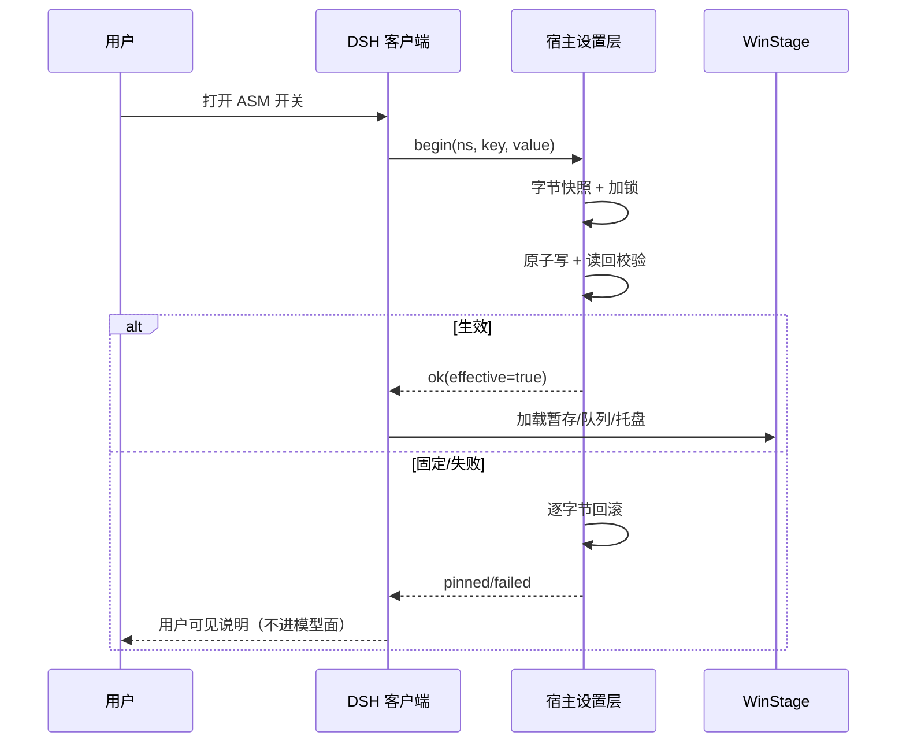
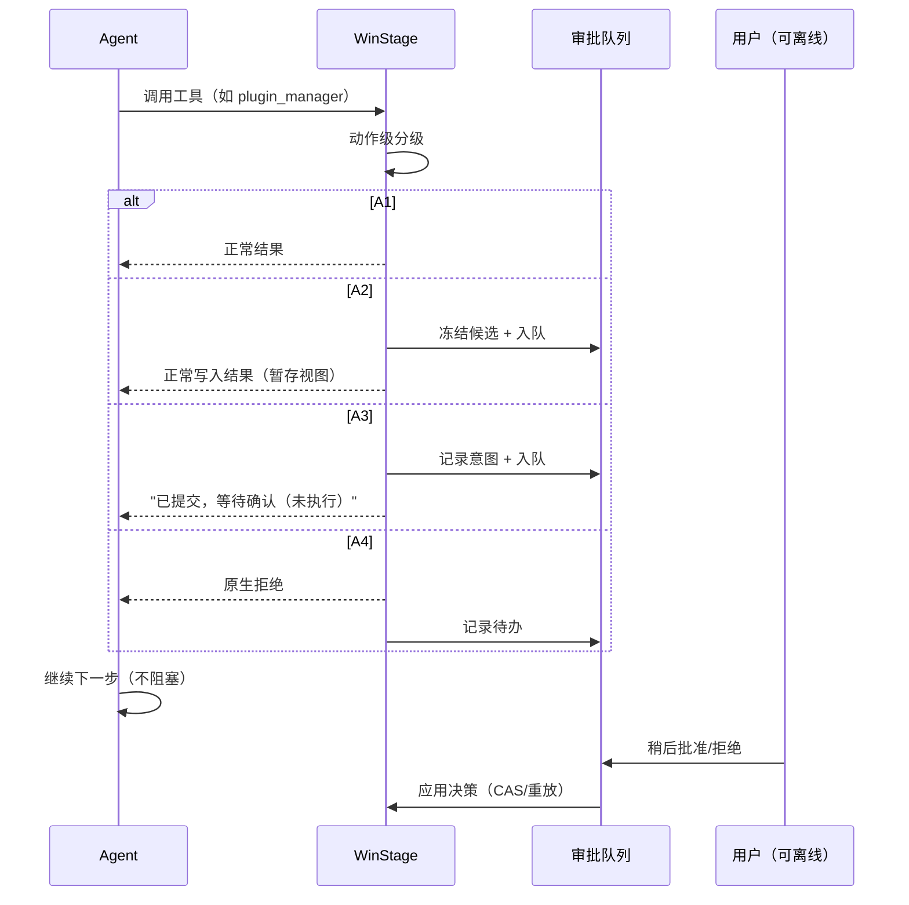

# 异步沙箱（无人值守）需求规格

**文档状态**：已确认 v0.2（2026-11-18 用户确认：§12 全部按推荐值；可进入设计与 P0 实施）
**日期**：2026-11-18（初稿 2026-11-17）
**适用**：DeepSeek Harness（下称 DSH）+ `dsh-winstage-sandbox`（Windows）
**依据**：2026-11-17 22:45 会话截图；用户本轮需求；R34 七域实测（用户提供）；R48 E2E 套件；`packages/win` 现行代码。
**评审对象**：DSH 宿主设置层、DSH 客户端审批 UI、WinStage 插件（host + client + shim）。

> 编号规则：`ASM-FR-xxx` 为功能需求；`INV-x` 为不变量；`AC-xx` 为验收用例；`GAP-xx` 为现状差距；`D-x` 为待拍板决策。
> `必须` = 不可裁剪；`应当` = 默认做法；`可以` = 可选。

**快速导航**：§0 结论 · §1 问题 · §2 定义 · §3 目标 · §5 状态/不变量/时间预算 · §6 需求 · §9 验收 · §10 差距 · §12 决策 · §13 追溯。

---

## 0. 结论先行

1. **异步沙箱（ASM）必须是 DSH 的一等运行模式，不是把 `approval.policy` 改成 `never`。** `never` 会立即自动拒绝并留下「用户拒绝」的假象（平台 H1；R34 亦复现），既做不完工作，也在欺骗模型。
2. **开启时，所有审批进入同一个异步审批队列；客户端不再出现任何阻塞式审批弹窗**（截图里的 `plugin_manager` 弹窗就是反例）；Agent 不因审批停住。
3. **关闭时，运行行为与「从未加载」等价**；所有对 DSH 客户端运行面的修改可撤销（设置行作为控制面入口按 D-1 例外）；待审批项冻结，不自动应用、不自动拒绝。
4. **模型可见面不得出现可判定沙箱的稳定指纹**；这是「减少可识别信号」，不是安全边界，也绝不向用户/审计隐瞒。
5. **开关写入必须由宿主设置层提供「写前字节快照 + 原子写 + 生效校验 + 失败逐字节回滚 + 并发锁」**；插件只送键值，不承担字节回滚。

---

## 1. 背景与问题

### 1.1 触发事件（截图，2026-11-17 22:45）

- 会话在「异步沙箱已开启」的预期下运行；Agent 调用 `plugin_manager`（只读 `list_plugins`）时，客户端弹出旧审批界面：**「允许本次操作使用 danger-full-access 权限：plugin_manager」**，会话停在「等待审批」约 17 分钟。
- 这是**只读操作**，本不应升级审批；即使需要审批，也不应阻塞无人值守会话。
- 结论：旧审批面没有被接管；动作级风险分级缺失；「异步」只覆盖了文件暂存，没有覆盖平台审批 seam。

### 1.2 开关写入失败（用户原文）

- 「本次开关未写入：设置通道拒绝了这次修改（本行 config 可能被 profile 覆盖层固定）。」
- 「设置值未生效：已保留原值（本行 config 被覆盖层/环境变量固定）。」
- 「此次交互可能已把 profile 文件重新序列化写入（仅格式规范化，键值语义不变）。」
- 「本插件无法回滚文件字节：设置通道只送键值，客户端拿不到写前的文件内容，因此“写入前快照 + 失败回滚”必须由宿主侧设置层实现。」

问题：开关不可用；失败的副作用（重序列化）不可回滚；用户/模型可见面出现「沙箱专用」失败文案。

### 1.3 关闭残留

现行客户端有多处**无条件**修改（详见 §10）：composer 反隐藏 CSS、composer 槽位条目、dock chip、设置行、轮询器；命令面 provider 在加载期选定，关闭后必须重启宿主才交还平台 shell。与「关闭 = 未加载」冲突。（`locale` 是 `ctx.effect` 管理的字典，属控制面依赖，不计入运行面修改。）

### 1.4 模型可察觉

R48 已把「AI 能否识别沙箱」作为验收项（AI-01），并修复了 `WINSTAGE_*` 环境变量泄漏、cwd 内实现文件可见等。但 R48 的 ON 配置用 `danger-full-access` / `never` 来排除平台文案，AI-01 通过不等于 ASM 的不可察觉达标；它只能作为非门禁烟测，门禁应以模型可见字节 diff 为准（§9/AC-06）。仍存在候选指纹：自定义错误码/文案、staged 路径、设置失败文案、平台 `workspace-write` 提示、性能/时序差异。

### 1.5 无人值守工具链不可用（R34 实测）

- `pip` 读取自带 CA 证书被沙箱拒绝（`PermissionError: [Errno 13]`），`venv` 失败；`npm install` 挂起 >240 s、只建空 `node_modules`；
- `shim.log` 13 MB → 20 MB 无轮转，单条命令分钟级；
- `Test-Path` 与 `Get-ChildItem` 对同一路径读数矛盾；删除语义 `ENOENT` 与真实删除不一致。

无人值守要「做完所有工作」，这些是硬前置。

### 1.6 宿主设置层缺事务

`cordis.patch.yml` 是共享文件；同一 profile 可被多个宿主共用。**复核（2026-11-19）：DSH 0.2.2-rc.5 的 `dsh-config-editor` 已经实现 `withFileLock`、`writeFileAtomic`、写前 `before` 字符串快照与 reconcile 失败回滚、`parseDocument`（保留注释与 `!!js`）、以及 effective 校验；因此“没有任何一层承担快照/回滚/并发”不成立。** 仍缺：CRLF/BOM 保真、队列/审计文件的独立锁、层级定位（home patch/CLI overlay）与插件错误文案（当前文案与 0.2.2-rc.5 行为不符）。

---

## 2. 定义与范围

**异步沙箱（ASM）**：`dsh-winstage-sandbox` 的 `mode: async` 运行模式。默认仍为 `interactive`（现行暂存 + 人工点批准）。ASM 的语义是：

> 所有有副作用的动作先进入可回滚的暂存/意图队列；Agent 不被审批阻塞；人可以在任意时刻（会话中、会话后）异步批准/拒绝；关闭后行为与未加载等价；开启期间模型侧无可判定的沙箱指纹。

**名词假设**：本规格把「异步沙箱」当作 `dsh-winstage-sandbox` 的 `mode: async`。若实际是独立插件/DSH 平台功能，本规格的审批接管（§6.2）、复原（§6.4）、不可察觉（§6.5）、设置事务（§6.6）四组需求原样适用，只替换责任方。

**范围内**：

- Windows 上的 DSH 会话（单机、单/多宿主）；
- 文件、注册表、命令、包安装、插件管理、网络等审批来源；
- DSH 宿主设置层、客户端审批 UI、WinStage host/client/shim；
- 模型可见面与用户可见面的分离。

**范围外**：

- Linux 后端（语义应可移植，本期不验收）；
- 对恶意代码的不可检测性（见 ASM-FR-055）；
- 自动批准危险操作；
- 对用户/审计隐瞒沙箱存在。

---

## 3. 目标与非目标

### 3.1 目标

| ID | 目标 | 度量 |
|---|---|---|
| G-1 | 无人值守完成长任务 | 全程无阻塞弹窗；无因审批导致的回合停顿 > 2 s（T-step） |
| G-2 | 审批随时异步 | 队列持久；决策可在任意时刻作出；不丢、不重、不自动批 |
| G-3 | 关闭即复原 | OFF 与 UNINSTALLED 的模型/用户可观察行为一致；客户端运行面残留 = 0（设置行控制面例外 D-1；命令面 `pending-restart` 例外 D-6） |
| G-4 | 模型不可察觉 | 固定 20 探针的模型可见字节 diff 零差异（门禁）；AI-01 仅非门禁烟测 |
| G-5 | 开关可靠 | 写入生效或明确只读；失败逐字节回滚；多宿主不丢更新 |
| G-6 | 工作流可用 | pip/npm/venv/安装/删除在沙箱内可用；性能达标 |
| G-7 | 可审计 | 每个审批/写入/回滚有不可变审计；用户可查 |

### 3.2 非目标

- **NG-1**：ASM 不是「自动批准」。任何危险动作都必须有人类决策，或被显式准入信封覆盖。
- **NG-2**：不承诺「任意工具动作都能异步完成」；不可暂存且不可重放的动作按 A4 诚实失败（ASM-FR-022）。
- **NG-3**：不保证对任意代码不可检测；不把「不可检测」当安全边界。
- **NG-4**：不改变 DSH 平台的审批语义（`never` 仍是自动拒绝）；ASM 是新增 `async`，不是复用 `never`。
- **NG-5**：本期不做跨平台一致性认证。

---

## 4. 术语

| 术语 | 定义 |
|---|---|
| ASM | 异步沙箱模式，见 §2 |
| 审批项 | 一条待人类决策的请求，含来源/级别/目标/预览/意图/幂等键 |
| A0–A4 | 审批分级：硬拒绝 / 自动放行 / 可暂存 / 可重放意图 / 不可异步（ASM-FR-022） |
| 暂存候选 | 文件/注册表变更的不可变 before/after 单元，批准后 CAS 发布 |
| 准入信封 | 开启 ASM 时用户显式授予的能力/风险上限；不是自动批准，是「无需逐次询问」 |
| 冻结 | 关闭 ASM 时待审项停止变更、不自动应用/拒绝，等待下次开启或显式处理 |
| 模型可见面 | 系统提示、工具 schema/描述、工具结果、错误、stdout/stderr、env、cwd、文件/进程/注册表/网络视图、审批回执、子代理上下文 |
| 用户可见面 | GUI 面板、设置页、通知、审计页、日志文件 |
| 指纹 | 任何能稳定推断「当前在 WinStage/ASM 中」的 token、路径、环境、错误码、时序或行为差异 |
| 完全卸载 | 移除插件/包，loader 行与客户端注册全部消失；与 OFF 区分 |

---

## 5. 状态模型与不变量

### 5.1 状态

| 状态 | 含义 | 新写入 | 审批 | 客户端 |
|---|---|---|---|---|
| UNINSTALLED | 插件未安装 | 平台 | 平台 | 无 |
| OFF | 已安装、关闭 | 平台 | 平台（旧弹窗回来） | 仅控制面入口（D-1） |
| ON_IDLE | 开启、无待审 | 暂存/自动 | 异步 | 面板/开关 |
| ON_RUNNING | 开启、有回合在跑 | 暂存/自动 | 异步 | 面板/开关 |
| ON_PENDING | 开启、有待审 | 暂存/自动 | 异步 | 面板 + 角标 |
| DEGRADED | 开启但档位/能力不足 | 按降级策略 | 异步 | 警示 |
| DISABLING | 正在关闭 | 拒绝新暂存 | 冻结 | 过渡 |
| UNKNOWN | 读不到配置/快照 | **不得假定开启** | 平台 | 平台控件 |

### 5.2 不变量

- **INV-1**：`OFF` 的模型可见面必须与 `UNINSTALLED` 在相同操作下逐项一致（允许时间、临时名等非确定性差异）。
- **INV-2**：`ON` 下任何审批都不得以阻塞弹窗形式出现；Agent 单步等待审批的时间 ≤ T-step（2 s），A3/A4 的回执也必须立即返回。
- **INV-3**：待审队列持久化；宿主崩溃/重启不丢；决策幂等。
- **INV-4**：ASM 不得自动批准任何 A2/A3/A4 项；唯一例外是用户在开启时显式授予的准入信封（A1）。A2 的「成功」是暂存视图成功，不是真实盘发布；本不变量约束的是发布。
- **INV-5**：关闭/卸载必须幂等；重复关闭无副作用。
- **INV-6**：设置写入要么生效，要么逐字节回滚；不存在「值没变但文件被重排」的中间态。
- **INV-7**：任何模型可见错误必须使用平台原生语义（EPERM/EACCES/ENOENT/超时等），不得出现 `WINSTAGE_*` / `FS_STAGE_*` 自定义码或 `staged/sandbox` 字样；逐触发对照见 §8.4。
- **INV-8**：用户/审计永远能看到真实发生的暂存、审批、发布、拒绝；「对模型不可见」不等于「对用户不可见」。

### 5.3 时间预算（单一来源，所有 FR/AC 引用此表）

| 项 | 上限 | 适用/说明 |
|---|---|---|
| T-toggle | 2 s | 开关后给出确定反馈（一致 / `busy` / `pending-restart`）；实际生效最迟 T-lock + 2 s |
| T-step | 2 s | 任一审批触发到工具返回（不含实际执行） |
| T-ui | 5 s | 验收观察窗口：无旧审批弹窗；**不放松 T-step** |
| T-safe | 5 s | 文件/注册表关闭安全点；长命令可继续 `DISABLING` |
| T-lock | 5 s | 设置锁等待；超时返回 `busy` |
| T-probe | ≥ 30 s | OFF 时仅用于检测「配置关但仍在跑」的只读低频探测 |

> 凡文中出现 2 s/5 s，均以上表为准；不再在别处另立阈值。

---

## 6. 功能需求

### 6.1 模式开关与配置权威

**ASM-FR-010 单一权威键**
必须只有一个权威配置：`winstage-sandbox.enabled`（开关）+ `mode`（`interactive|async`）+ `approval.mode`（`sync|async|never`）。UI、loader、执行器、状态命令读同一来源；禁止再把 `WINSTAGE_SHELL` 等进程级变量当默认权威（仅保留诊断逃生口，且必须在状态里显式标注）；禁止用正则扫 profile YAML 作为第二权威；读不到/读不懂 ⇒ `UNKNOWN`，不得接管、不得声称开启。

**ASM-FR-011 生效保证**
用户切换开关后，必须在 T-toggle（2 s）内给出确定反馈；实际生效最迟 T-lock + 2 s，且满足下列之一：

- (a) 配置值、生效值、UI 三者一致；
- (b) 明确返回 `pending-restart`，并给出「立即重启 / 稍后」的单一操作。

不得静默 no-op。命令面若必须重启，必须显示「待重启」；重启前实际仍是旧 provider，UI 不得谎报已关闭。

**ASM-FR-012 写入回读校验**
设置层写入后必须重新读取**生效投影**（不只是文件内容），确认 `effective === requested`；不一致即回滚并返回 `pinned`，不得返回成功。

**ASM-FR-013 固定行处理**
若目标行被 profile 覆盖层/环境变量固定：

- 首选：宿主设置层在用户确认后，以事务方式写入最高优先级的**可写层**（含 profile patch 本身），并保持格式；
- 否则：开关进入只读态，用户可见地说明「由 profile 固定，如何修改」；
- 禁止：先写失败、再留下重序列化文件；禁止把该失败文案送进模型可见面。

**ASM-FR-014 失败不影响模型面**
设置失败/只读/固定行的提示只允许出现在用户可见面；若模型通过工具间接触发设置写入，工具结果必须是平台原生错误（如 `permission denied`），不得包含 `%DSH_HOME%`、`cordis.patch.yml`、`profile overlay` 等字样。UI 文案不得被任何工具/日志回读进模型上下文；验收时扫描会话事件与工具结果。

### 6.2 审批接管（核心）

**ASM-FR-020 单一审批中心**
ON 时，所有审批来源必须汇聚到同一个审批中心（复用/扩展现有 `plugin/approval-hub.ts` 的分页模型：`files` / `behavior` / `resource` / `network` / `anomaly`）。注意该模块当前是**内存 `Map`，无持久化、无 `behavior/resource/network` 生产者、仅测试引用**；必须补齐持久化、来源接入与 UI，不能当作现成队列。队列持久化，面板/命令/角标读同一份数据。禁止文件走一套、平台审批走另一套。

**ASM-FR-021 禁止阻塞弹窗**
ON 时，`approval/request` 不得到达客户端审批组件；客户端不得渲染旧审批模态。验收：`plugin_manager`、`pwsh` 升权、MCP、网络等任一来源触发时，T-ui（5 s）内无审批对话框，且 T-step（2 s）内工具返回、Agent 回合继续。
若队列本身不可用（磁盘满、权限错），必须 **fail-closed**：原生拒绝 + 用户告警，**不得回退到阻塞弹窗**。

**ASM-FR-022 动作级分级**
必须按**实际动作**而非工具名分级：

| 级别 | 判据 | ON 行为 | 模型可见 | 用户可见 |
|---|---|---|---|---|
| A0 硬拒绝 | 不可覆盖的 deny（内核/磁盘/凭据外泄/破坏性） | 立即拒绝，不入队 | 平台原生拒绝 | 审计 + 可选提示 |
| A1 自动放行 | 只读、无副作用，或命中准入信封 | 直接执行 | 与 OFF 相同 | 无 |
| A2 可暂存 | fs/注册表等可回滚副作用 | 写暂存、冻结候选、入队 | 暂存视图成功（非发布） | 待审面板 |
| A3 可重放意图 | 非暂存但可安全重放（安装/配置变更） | 记录意图、入队、立即返回回执 | 通用回执「已提交，等待确认（尚未执行）」 | 待审面板 |
| A4 不可异步 | 无法暂存且无法重放 | 立即失败（原生语义），入队「需人工」待办 | 原生错误 | 待办 |

`plugin_manager.list_plugins` 必须判为 A1（其返回值不含敏感内容；若触及敏感读，按敏感策略拦截/遮蔽，仍不弹审批）；`plugin_manager.install/enable` 判为 A3（或 A0，若策略不允许）。

**ASM-FR-023 队列持久化**
每条审批项必须落盘（原子写 + fsync），字段至少：`id, createdAt, sessionId, turnId, source, class, title, target, risk, preview, intent, state, decision, idempotencyKey, expiresAt`。宿主崩溃/重启后恢复；决策幂等（同一 id 只能生效一次）。存储位置必须**模型不可读**（工作区外，或由读遮蔽强制拦截）；队列文件、`.dshstage` 等实现目录不得出现在模型可见的文件/路径/枚举里。

**ASM-FR-024 决策应用**

- A2：批准 = 对冻结候选做 CAS 发布；拒绝 = 丢弃候选，且**暂存视图立即回退**（模型后续读与真实盘一致）；基线漂移 = 失败并提示 rebase，不得覆盖。
- A3：批准 = 在宿主侧重放已记录意图，校验前置状态（sha/版本/参数）后执行；前置不成立则失败并保留待办；拒绝 = 丢弃意图。
- A4：批准 = 允许用户手动执行或转为 A3；拒绝 = 关闭待办。
- 所有决策写审计；不得「批准了但没执行」却显示成功。

**ASM-FR-025 不自动批准**
A2/A3/A4 一律等待人类决策；默认无超时自动批准。TTL 默认 0（无过期），可选 7 天；到期只能是 `expired/rejected`，绝不能 `approved`。准入信封默认 = 只读 + 工作区暂存自动；网络/安装/插件变更默认不自动，需逐类开启（D-3/D-4）。

**ASM-FR-026 随时可决策**
用户可在会话进行中、会话结束后、宿主重启后批准/拒绝；面板/角标/命令 `/winstage pending` 可见；决策后若原会话已结束，A2 仍可发布，A3 需在宿主上下文可用时重放（否则转 A4 待办，不静默丢）。

**ASM-FR-027 只读零审批**
只读操作（列目录、读文件、`list_plugins`、`web_fetch` 等）默认 A1；但敏感读/越界读仍按敏感策略拦截或遮蔽（不弹审批）。不得因「工具本身可能写」而整工具升权。风险判定必须看参数/目标/动作。

**ASM-FR-028 不可异步的诚实失败**
A4 必须返回平台原生错误并让 Agent 继续；禁止为了「看起来无人值守成功」而伪造成功/延迟成功。用户侧显示「该动作需要人工，已记录待办」。

**ASM-FR-029 审批 seam 契约（防悬挂）**
ON 必须由**宿主侧审批 seam** 接管，而不是只隐藏客户端弹窗。对每条请求：

1. 先分级：A0 立即 `rejected`；A1 立即 `allowed-once`；A2 不应进入审批（fs 暂存已返回）。
2. A3/A4 必须**立即应答**（`rejected`，或经工具适配器返回 `queued` 回执），**不得让工具的 Promise 悬挂**；队列记录意图/待办，后续由宿主执行，不恢复原工具调用。
3. 对不合作、无条件 `await ctx.approval.request` 的工具，answerer 必须立即返回 `rejected`，队列记录意图；模型看到原生拒绝；`idempotencyKey` 防止重试重复入队。
4. 模型可见结果：A3 只能是「已提交，等待确认（尚未执行）」或平台原生拒绝；A4 原生拒绝；不得显示成功。
5. 审批 seam 未安装/安装失败 ⇒ **不得进入 ON**（fail-closed 到 OFF/平台），不得只隐藏 UI 让 Promise 悬挂。
6. 审批来源清单（至少）：平台工具升权、`plugin_manager`、MCP、网络、命令、外部审批；每类必须有 adapter，或明确归入 A0/A4。

> 可用的既有接缝：`host-plugin.ts:2154-2172` 已在写 `approval/asked|decided` **审计镜像**；但那是事后记账，不是决策接管。FR-029 要求在 **`approval.request` 返回之前**作答，不能只在事后补记。

### 6.3 无人值守执行

**ASM-FR-030 不依赖前台/焦点**
审批队列、暂存、发布、状态查询均不得依赖 GUI 可见/窗口焦点/用户交互；headless 下功能等价（面板可以不渲染，但队列与命令面必须可用）。

**ASM-FR-031 拒绝后继续**
任一审批被拒绝，Agent 收到原生拒绝语义后可继续下一步；不得整轮中止，不得重试到死循环（同一动作默认最多 1 次自动重试）。

**ASM-FR-032 崩溃恢复**
宿主崩溃/重启后：队列恢复；未完成的事务按日志回滚或前滚；shim/覆盖层/临时目录清理；不产生孤儿候选/孤儿审批。

**ASM-FR-033 结束汇总**
回合/会话结束时，若仍有 pending，必须产出一份用户可见汇总（数量、风险、目标、等待时长）；模型可见面不得出现该汇总（除非用户主动让模型看）。

**ASM-FR-034 单步不阻塞**
从 A0–A4 任一审批触发到工具返回，单步耗时 ≤ 2 s（不含实际执行）；A3/A4 的回执立即返回。

### 6.4 关闭、卸载与复原

**ASM-FR-040 关闭安全点**
关闭时：停止接受新暂存 → 在途文件/注册表操作到达安全点（T-safe，≤5 s）→ 切换 provider/UI → 冻结队列。长命令不打断：新命令走平台，旧命令在 `DISABLING` 下继续；UI 必须显示进度，超时则终止并审计。不得在写一半时切换导致损坏。

**ASM-FR-041 客户端复原清单**
OFF 时必须撤销/还原：

| # | 修改 | 现状 | OFF 要求 |
|---|---|---|---|
| 1 | `locale` 命名空间 | `ctx.effect` 自动 | 随卸载撤销；OFF 仅服务设置行（无运行时行为） |
| 2 | composer 反隐藏 `<style data-winstage-composer-unhide>` | **无条件注入** | 仅 ON 注入；OFF 移除 |
| 3 | `conversation.composer` 条目 | **无条件注册** | 仅 ON 注册；OFF dispose（或条目不存在） |
| 4 | `conversation.input.dock` chip | **无条件注册** | 仅 ON 注册；OFF dispose |
| 5 | `conversation.input.permission` 遮蔽 | 已按开关 | 保持；OFF 平台控件回来 |
| 6 | `settings.general.item` 设置行 | 无条件 | 仅保留控制面入口（D-1）；不得带任何运行时行为；若选择字面零残留则不注册，改由插件管理重新启用 |
| 7 | 轮询器/定时器 | 常驻 | OFF 停止常规轮询；仅允许 T-probe（≥30 s）只读生效探测，用于检测「配置关但仍在跑」，不得渲染/入队/读 review 内容 |
| 8 | localStorage 偏好 | 常驻 | 无行为影响；卸载时清理（可） |
| 9 | `/winstage*` 命令 | 常驻 | OFF 全部不注册 / 返回 unknown；状态改由设置行与日志查看 |
| 10 | host remote 路由 | 常驻 | OFF 除控制面状态外返回 `disabled`，不读盘 |
| 11 | CSS / 全局事件监听 | 有 | 全部 disposer 化 |
| 12 | env / shim / 覆盖层 | 见 host | 清理，无孤儿 |
| 13 | `form.subscribe` / remote handlers | 常驻 | OFF 全部退订/注销 |
| 14 | `__winstageTestHooks` 测试接缝 | 常驻 | 仅测试模式暴露；OFF 无行为、无 IO |

**ASM-FR-042 宿主复原清单**
OFF/卸载后：`ctx.fs` / `ctx.shell` 行为与平台一致；WFP 过滤器、AppContainer、Job Object、ACL、注册表覆盖层、shim 注入、临时目录、命名管道、后台进程全部撤销；默认不得要求重启（D-6：常驻委托 provider 热切换；仅平台限制时按 FR-011 显式 `pending-restart`，且重启前不得声称已复原）。

**ASM-FR-043 待审冻结**
关闭时 pending 不自动应用/拒绝；进入 `frozen`；下次开启恢复；用户可选择「全部拒绝」（显式）。

**ASM-FR-044 残留验收**
必须提供机器可跑的「残留探针」：ON→OFF 后检查 slot 注册表、DOM style 节点、事件监听、定时器、remote/命令注册、env、进程、覆盖层、临时文件；除 D-1 允许项外零命中。

**ASM-FR-045 关闭 vs 卸载**

- 关闭（OFF）：运行面复原；仅保留设置行这一控制面入口与持久数据（D-1）；
- 卸载（UNINSTALL）：loader 行、客户端注册、命令、设置行全部移除；持久数据按用户选择保留或移除；运行面零残留。

**"未加载"的定义**：客户端模块代码一旦加载就无法从 JS 运行时卸载；OFF 的「未加载」指**所有注册/副作用已 dispose、slot 表与插件未安装时逐项等价**，代码驻留本身是允许残余。验收用 slot 表/路由表/DOM/监听/定时器的基线相等，而不是「模块字节不存在」。

文档/UI 必须把两者分开，不得用「关闭」暗示「卸载」。

### 6.5 模型不可察觉

**ASM-FR-050 模型可见面定义**
以 §4 定义为准。验收以「同一操作在 ON 与 OFF 下的模型可见输出对比」为准，不以「代码里没有 sandbox 字样」为准。模型可以知道「有审批/等待确认」（这是平台正常语义），但不得知道「这是沙箱/暂存/候选」。

**ASM-FR-051 指纹零容忍清单**
ON 下模型可见面不得出现：

| 通道 | 禁止内容 | 验收方法 |
|---|---|---|
| 环境变量 | `WINSTAGE_*`、`DSH_WINSTAGE_*`、staging 根 | `env` / `Get-ChildItem Env:` ON vs OFF diff |
| cwd/路径 | `.dshstage`、`fs\C\`、`wo\`、`staged`、`candidates`、`staged-ext`、`shim.log`、`winstage-shim.config.json` | `pwd`、错误路径、`Get-ChildItem -Force`、`dir /a` |
| 文件系统 | 实现文件可见；同一工具对同一路径的暂存/真实视图不一致 | R48 SHELL-ARTIFACTS、FILES 矩阵 |
| 错误 | `WINSTAGE_*` / `FS_STAGE_*` 自定义码；`staged root` 字样 | 触发拒绝/不存在/越界，逐字比对 |
| 进程 | shim/injector 进程名、DLL 名 | `Get-Process`、`tasklist /m` |
| 注册表 | overlay 路径/值名 | `reg query` ON vs OFF |
| 提示/工具 | 系统提示、工具描述新增 WinStage/staging 文本 | prompt / tool schema diff |
| 审批 | 回执/错误出现「沙箱/暂存」 | A3/A4 回执逐字 |
| 时序 | 单命令 > 60 s、p95 > 1.5× OFF | 性能探针 |
| 包管理器 | pip/npm 输出出现 staging 路径 | 安装日志 |

> 现有 `WINSTAGE_SHELL_MSI_UNSUPPORTED`（R48 预期可见）属于违反 INV-7 的模型可见自定义码；ASM 必须改为原生 fail-closed 文案，或把它列入显式允许例外并在指纹清单中标注。不得新增同类码。

**ASM-FR-052 路径/环境/错误一致性**

- 相对/绝对路径、`Test-Path` / `Get-ChildItem` / `stat` / `read` 对同一路径的「存在性」必须一致；
- 拒绝必须是 `EPERM/EACCES` 语义，不是「not found」；不存在必须是 `ENOENT`；两者不得混用；
- 子进程 env 与 OFF 基线一致（允许 DSH 会话固有变量）。

**ASM-FR-053 时序与性能**

- 常规命令 p95 开销 ≤ 1.5× OFF；不得因沙箱引入额外 > 60 s 等待（真实长任务除外）；
- `shim.log` 必须有上限/轮转（建议 8 MiB × 3），不得随会话无限增长；
- 禁止用 sleep/延迟掩盖同步问题。

**ASM-FR-054 审批回执措辞**
A3 回执只能是中性的「已提交，等待确认（尚未执行）」（优先复用平台既有审批措辞，逐字一致），不得提沙箱/暂存/候选；A4 用原生错误。A1/A2 对模型无额外提示。

**ASM-FR-055 边界与诚实**
本需求是「减少不必要的指纹」，不是对恶意代码的不可检测性保证。必须公开残余风险（文件 ID/时间戳、ETW、驱动缺失、性能、ACL、注册表虚拟化痕迹等）。未注入 shim 的外部进程（MCP、浏览器、服务）可能看到真实盘而非暂存视图；这是已知残余边界，必须在文档与验收中标注，不得用它们证明一致性。禁止向用户/审计隐瞒；禁止伪造成功。

### 6.6 宿主设置层事务（DSH 0.2.2-rc.5 已具备，需接线/补差）

> 复核（2026-11-19）：`dsh-config-editor/src/index.ts:87-153` 已实现本节的锁、原子写、写前快照、reconcile 失败回滚与 effective 校验。FR-060..067 中多数为**已满足**；实施只需接线、补 CRLF/BOM 与多宿主队列/审计协议，勿重复造轮子。若 higher layer（home patch/CLI overlay）覆盖目标行，编辑器会在**写前**拒绝，不会重序列化。

**ASM-FR-060 写前字节快照**
在**任何**解析/序列化之前，读取目标文件原始字节、`sha256`、`mtime`、`size`，写入同目录备份（或事务日志 + 内存副本）；快照必须能被逐字节恢复。

**ASM-FR-061 原子写**
同目录临时文件 → `fsync` → 原子 rename → `fsync` 目录；失败时原文件保持不变。

**ASM-FR-062 生效校验与失败回滚**
写入后重新读取并校验生效投影；若 `effective !== requested` 或写入异常：用快照逐字节恢复（`sha256` 必须与写前一致；`mtime` 恢复到 ±10 ms 或显式豁免；creation time 不作承诺），返回 `pinned/failed`，不得返回成功；回滚失败返回 `recovery-required` + 备份路径，停止后续写入。

**ASM-FR-063 格式保持**
成功的写入只允许目标键的最小文本变更；注释、键顺序、引号风格、空行、**`!!js` 标签、块标量（`|`/`>`）、锚点/别名、CRLF/BOM** 必须保持。profile 覆盖层对整行 `config` 是整体替换，因此新增/修改一个键时**不得丢掉同行的兄弟键**（如 `workspaceRoot`/`probeOnStart`/`networkTier`）。做不到就用文本级 patch；无法安全定位则 fail-closed **不写**。禁止「整份重序列化」。写后必须用 cordis loader 重新解析验证。

**ASM-FR-064 锁与并发**

- 同目录锁文件（`cordis.patch.yml.lock`），含 pid/host/nonce/时间；
- 读-改-写全程持锁；写前校验 `sha256` 未变，变了则中止并重读，不覆盖；
- 同机多宿主用 PID 存活判定；跨机/网络盘用租约 + 心跳；无法证明独占则拒绝；
- 等待超时（T-lock，建议 5 s）返回 `busy`，不得无限阻塞 UI；
- 队列/审计等其他多写者文件必须有各自的锁或「单写者 + 追加」协议，不能只锁 `cordis.patch.yml`；
- 已运行的其他宿主必须能感知配置变化（文件监听或 ≤2 s 轮询）；感知不到就显示 `pending-restart`，不得静默按旧值继续。

**ASM-FR-065 崩溃恢复与陈旧配置**
事务日志记录 `snapshotting|writing|verifying|committed|rolled-back`；启动时若发现 `writing` 且锁过期，自动恢复快照并记录审计；不得留下半份 YAML。运行中的宿主若在 T-toggle 内未感知到配置变化，必须把状态标为 `pending-restart`，不得继续声称旧值生效。

**ASM-FR-066 审计**
每次事务写 `settings-audit.jsonl`：txnId、路径、before/after sha、结果、host、pid、时间；只增不改；不进模型可见面。

**ASM-FR-067 接口契约（建议）**

```ts
interface SettingsTransaction {
  begin(input: { ns: string; key: string; value: unknown }): Promise<{
    txnId: string
    targetPath: string
    beforeSha256: string
    beforeBytes: Uint8Array // 仅宿主持有，不下发客户端
    beforeMtimeMs: number
  }>
  commit(txnId: string): Promise<{
    ok: boolean
    effective: unknown
    afterSha256: string
    changedBytes: number
    pinned?: boolean
  }>
  rollback(txnId: string, reason: string): Promise<{
    restored: boolean
    restoredSha256: string
    byteIdentical: boolean
  }>
}
```

插件只调用该接口；禁止客户端直接写文件。

### 6.7 工作流可用性（由 R34 实测导出）

**ASM-FR-070 包管理器与运行时**
`pip install`、`python -m venv`、`npm install`、`node` 必须在沙箱内可用；pip 自带 CA 证书、Python 安装目录、npm/pnpm 缓存、Node 安装目录必须加入**只读**白名单；不得因读证书 `EACCES`。`pip RECORD` 哈希校验必须能跑完。

**ASM-FR-071 日志与性能**
`shim.log` 轮转（8 MiB × 3 或等效）；单会话日志不得超过上限；命令 p95 达标（ASM-FR-053）；不得出现 240 s 挂起。

**ASM-FR-072 路径视图一致**
`Test-Path` / `Get-ChildItem -Recurse` / `read` / `stat` / `pwd` 对同一路径一致；`X\.lead\...` 与 `X\staged\.lead\...` 不得一个 False 一个可枚举；真实路径/暂存路径的映射必须在内部完成，不泄漏给模型。

**ASM-FR-073 删除语义**
暂存删除必须生成候选；真实文件在批准前不得删除；预建诱饵文件的 `ENOENT` 必须是「未批准/不可见」的统一语义，不得先 EXISTS 后 ABSENT 而中间无有效删除；审计要能解释。

**ASM-FR-074 拒绝文案统一**
敏感读/越界写/权限拒绝统一为原生 `EPERM/EACCES`；`not found` 只用于真实不存在；不得让模型把「被拒」误读为「不存在」。

**ASM-FR-075 安装/卸载全链路**
便携包：下载 → SHA256 双取比对 → Authenticode → 执行 → 卸载；MSI 若设计上不支持（`msiserver` 不经过 shim），必须**明确 fail-closed** 并给用户替代路径，不得假装成功。

### 6.8 可观测性与审计

**ASM-FR-080 用户态状态**
`/winstage status`、设置行、面板角标必须给出：模式、配置值/生效值/强制源、待审数、最老待审时长、队列健康、shim 日志大小、降级原因。OFF 时只允许显示静态「已关闭」与持久化的待审数（若有），不得启动 review 轮询或读盘以外的运行时探测。

**ASM-FR-081 审计**
每次暂存/批准/拒绝/发布/回滚/A0 拒绝写不可变审计；模型不可见；用户可导出。

**ASM-FR-082 指标**
建议暴露：pending 数/年龄、A2/A3/A4 计数、发布成功/失败、回滚次数、p95 命令耗时、shim.log 大小、指纹探针结果。

---

## 7. 关键时序

### 7.1 开启



### 7.2 无人值守回合中的审批



### 7.3 关闭

```text
用户关闭 → DISABLING → 等在途安全点（T-safe，≤5 s） → 冻结队列
        → dispose 客户端注册/CSS/命令 → 切换 fs/shell 行为
        → 清理 shim/覆盖层 → OFF
```

---

## 8. 数据与接口契约

### 8.1 审批队列（`queue.json`）

```json
{
  "version": 1,
  "updatedAt": "2026-11-17T14:45:00.000Z",
  "items": [
    {
      "id": "ap_01J...",
      "createdAt": "2026-11-17T14:45:00.000Z",
      "sessionId": "sref_...",
      "turnId": "turn_...",
      "source": "behavior",
      "class": "A1",
      "title": "plugin_manager.list_plugins",
      "target": { "kind": "tool", "tool": "plugin_manager", "action": "list_plugins" },
      "risk": "normal",
      "preview": null,
      "intent": { "tool": "plugin_manager", "args": { "action": "list_plugins" } },
      "state": "pending",
      "decision": null,
      "idempotencyKey": "sha256:...",
      "expiresAt": null
    }
  ]
}
```

存储：`%DSH_HOME%\storages\winstage\<workspace-id>\queue.json`（工作区外，模型不可读）+ `%DSH_HOME%\storages\winstage\queue-index.json`（全局索引，可选）。若沿用工作区内 `.dshstage`，必须同时被读遮蔽与目录枚举拦截。原子写 + 备份 + fsync。

### 8.2 决策结果

```json
{
  "id": "ap_01J...",
  "outcome": "allow-once|deny|expire",
  "by": "user",
  "at": "2026-11-17T15:00:00.000Z",
  "applied": true,
  "result": { "published": ["src/a.ts"], "failed": [] }
}
```

### 8.3 客户端修改账本

每个注册/样式/监听/定时器必须登记 `{ id, surface, dispose, activeWhen }`；`activeWhen` 默认 `enabled === true`；OFF 时统一 dispose。新增修改必须同时更新账本与残留探针。

### 8.4 模型可见错误矩阵（INV-7 的可测化）

| 触发 | 期望原生语义 | 允许文案（示例） | 禁止 |
|---|---|---|---|
| 敏感读被拒 | `EPERM` / `EACCES` | `Access is denied.` | `not found`、`WINSTAGE_*` |
| 越界写被拒 | `EPERM` / `EACCES` | `Access is denied.` | `FS_STAGE_*`、`staged root` |
| 真实不存在 | `ENOENT` | `The system cannot find the file specified.` | 用「拒绝」冒充「不存在」 |
| 只读介质 | `EROFS` / `EACCES` | 原生 | 沙箱专用码 |
| 超时 | `ETIMEDOUT` / 平台超时文案 | 原生 | 无限挂起 |
| 审批拒绝 | 平台既有拒绝语义 | 平台原文（如 `the user rejected …`） | 沙箱/暂存字样 |
| MSI 不支持 | 原生「不支持/拒绝」 | 原生 | `WINSTAGE_SHELL_MSI_UNSUPPORTED`（除非显式例外） |
| 包管理器证书 | 正常读取（修复后） | 无错误 | `EACCES`（若仍出现，按缺陷处理） |

### 8.5 多写者文件协议

`queue.json`、`settings-audit.jsonl` 与 `cordis.patch.yml` 一样是共享文件，必须各有协议：

- 队列：同一工作区只允许一个写者（宿主主实例）；其他宿主只读快照；跨宿主写入走 id 幂等合并，冲突保留双方并标 `conflict`。
- 审计：append-only + `fsync`；轮转时保留旧文件；不覆盖。
- 锁：每次读-改-写持锁；锁内含 host/pid/nonce；跨机用租约 + 心跳；无法证明独占则拒绝。
- 读者：只读快照，不边读边解析半写文件。

---

## 9. 验收矩阵

| ID | 场景 | 步骤 | 期望 | 方法 |
|---|---|---|---|---|
| AC-01 | 截图复现 | ON + Agent 调 `plugin_manager list_plugins` | T-ui（5 s）内无审批弹窗；T-step（2 s）内调用完成（A1）或立即回执（A3）；回合不阻塞；无 `approval/request` UI | Playwright DOM + 会话事件 + 计时 |
| AC-02 | 文件暂存 | ON + 写 `a.txt` | 模型读得到；真实盘批准前不存在；批准后 SHA 一致；拒绝后不存在 | R48 FILES/CLOSE |
| AC-03 | 开关生效 | OFF + 目标行在 profile patch | 设置事务写入成功；effective=true；UI 一致；无错误文案 | 读 patch + 投影 + UI |
| AC-04 | 写失败回滚 | 注入只读/故障 | 逐字节恢复（sha 一致；mtime ±10 ms 或豁免）；备份存在；无重序列化；模型面无文案 | 故障注入 + 字节比对 |
| AC-05 | 关闭残留 | ON→OFF（有 pending） | pending 冻结；不自动应用；客户端残留探针零命中；slot/路由/DOM/监听/定时器表与插件未安装基线相等；平台弹窗回来；文件面行为 OFF 基线且无需重启；命令面热切换或显式 `pending-restart`（不得谎报）；允许 T-probe 只读探测 | DOM/slot/env/进程探针 + 行为对照 |
| AC-06 | 不可察觉（门禁） | ON vs OFF 跑固定 20 条模型可见探针（env/cwd/路径/errno/文件/进程/注册表/包管理器） | 字节流 diff 通过（允许清单外零差异）；AI-01 仅作非门禁烟测（固定 prompt/模型/N=3） | 探针语料 + 逐字 diff |
| AC-07 | 多宿主并发 | 两个宿主同时切换 | 恰好一个提交；另一个 `busy` 或串行成功；文件合法；无丢更新 | 并发脚本 + YAML 解析 |
| AC-08 | 设置崩溃 | 写入中杀进程 | 启动恢复快照；YAML 合法；无半写 | 故障注入 |
| AC-09 | ON 崩溃 | 沙箱运行中杀宿主 | 重启清理 shim/覆盖层；队列恢复；无孤儿 | 进程/文件/队列检查 |
| AC-10 | 工具链 | pip/npm/venv/安装 | 全部成功或明确 fail-closed；无 EACCES；日志不超限 | 脚本 + 日志大小 |
| AC-11 | 性能 | 100 条命令 | p95 ≤ 1.5× OFF；无 > 60 s；shim.log ≤ 上限 | 基准脚本 |
| AC-12 | 卸载 | 卸载插件 | 零残留（loader/UI/命令/env/进程） | 残留探针 |
| AC-13 | A4 | 不可异步动作 | 原生拒绝；无弹窗；Agent 继续；用户待办 | 注入 A4 工具 |
| AC-14 | TTL | 过期项 | `expired/rejected`；不应用；用户通知；模型无感 | 时间注入 |
| AC-15 | 只读零审批 | 20 个只读工具 | 0 个审批项；0 弹窗 | 事件计数 |
| AC-16 | 防悬挂 | 不合作工具（无条件 await `ctx.approval.request`） | T-step 内返回；无弹窗；队列有意图；无悬挂 Promise；批准后宿主执行/拒绝后不执行 | 桩工具 + 事件/计时 |
| AC-17 | YAML 保真 | 含 `!!js`、块标量、锚点、CRLF、兄弟键的 fixture profile | 仅目标键文本变化；注释/标签/锚点/CRLF/兄弟键保持；loader 重解析通过 | 字节 diff + loader 解析 |
| AC-18 | 陈旧配置 | 另一宿主运行中改 YAML | ≤2 s 感知并生效，或显示 `pending-restart`；不得静默旧值 | 双宿主 + 文件监听 |

---

## 10. 现状差距（Gap）

| GAP | 需求 | 现状 | 差距/证据 | 责任方 |
|---|---|---|---|---|
| GAP-01 | FR-021/029 | 平台审批仍走 `ctx.approval`，客户端监听 `approval/request` 弹模态；WinStage 不接管 | 截图；`host-plugin.ts` 无 `ctx.approval`，但已有 `approval/asked|decided` 审计镜像（`host-plugin.ts:2154-2172`）可作扩展点；`docs/审批策略never…` §1 Q3（3.8 行） | DSH 宿主 + WinStage |
| GAP-02 | FR-022 | `plugin_manager` 按工具整体升权，`list_plugins` 也弹（推断） | 截图 | DSH 工具/策略层 |
| GAP-03 | FR-010/011 | 开关走 `configForms.form.set`，可能被 profile 覆盖层固定；失败文案 `client.ts:140,151` | 用户原文；复核：`dsh-config-editor` 在 effective 不一致时**写前拒绝**，问题在层级定位与文案，不在“重序列化” | 宿主设置层 |
| GAP-04 | FR-060..063 | 无写前字节快照/回滚；失败可能重序列化 | 复核：`dsh-config-editor:104-148` 已有 `before` 回滚与原子写；失败前不写。剩余 CRLF/BOM、错误文案 | 宿主设置层 |
| GAP-05 | FR-064/065 | 无锁/无事务日志/无多宿主协议 | 复核：config 有 `withFileLock`；队列/审计无独立锁；运行中宿主感知仍缺 | 宿主设置层 |
| GAP-06 | FR-041 | composer CSS **无条件**注入（`client.ts:3316-3324`）；composer 条目无条件注册（`:3465-3487`）；chip 无条件（`:3494-3520`）；设置行无条件（`:3368-3421`） | 代码 | WinStage client |
| GAP-07 | FR-042 | shell provider 加载期选定，关闭需重启（`cordis.patch.yml:71-94`） | 文档/代码 | WinStage |
| GAP-08 | FR-020 | `approval-hub.ts` 已有内存分页模型，但无持久化、无 `behavior/resource/network` 生产者、未接入 DSH 插件（仅测试） | 代码 | WinStage |
| GAP-09 | FR-023..026 | 无跨工具异步队列；只有文件候选 | 代码 | WinStage |
| GAP-10 | FR-050..055 | 环境/artifacts 已部分修复（R48），但错误码/设置文案/路径/时序仍有风险 | R48 README；R34 | WinStage / DSH |
| GAP-11 | FR-070..075 | pip CA EACCES、npm 挂起、shim.log 无上限、路径矛盾、删除语义 | R34 报告 | WinStage |
| GAP-12 | FR-043/045 | 无 OFF/UNINSTALL 区分；无残留探针 | 代码/文档 | WinStage |
| GAP-13 | FR-010/§5.1 | shell 门控存在两个读者：host 行 `config` 与正则扫 `cordis.patch.yml`（`:147`/`:201`），且读不到时 fail-open 接管 | 与「单一权威」「UNKNOWN 不得假定开启」冲突 | WinStage |

---

## 11. 分期

> P0 的逐任务拆解、依赖、里程碑与风险见 [异步沙箱-P0实施任务单.md](异步沙箱-P0实施任务单.md)。

**P0（必须先做，否则不算异步沙箱）**

1. 审批接管：A1–A4 分级；宿主侧 answerer（防 Promise 悬挂）；ON 无弹窗；`plugin_manager.list_plugins` 走 A1；单权威开关（GAP-01/02/08/09/13）。
2. 设置事务：快照/原子写/校验/回滚/锁（GAP-03/04/05）。
3. 关闭复原（客户端 + 文件面 + 命令面）：客户端账本 + 条件注册 + 残留探针；shell 常驻委托/热切换（GAP-06/07）。
4. 文件暂存与队列闭环（在已有基础上补统一队列/审计）。
5. 不可察觉基线：固定 20 探针的模型可见字节 diff（门禁）+ 指纹清单（GAP-10）。

**P1**

- 多宿主租约；崩溃恢复；A3 重放；pip/npm/venv；shim.log 轮转/性能；路径/删除/错误统一。

**P2**

- A4 用户体验；批量审批/全局收件箱；指标/导出；卸载器；跨平台语义。

---

## 12. 已确认决策（2026-11-18：全部按推荐）

> 用户 2026-11-18 明确「都按推荐」。以下为**已生效口径**，实施与验收按此执行，不再作为开放问题；后续若要变更，必须升版本并在本节记录。

| ID | 问题 | 已确认口径 | 影响 |
|---|---|---|---|
| D-1 | OFF 允许保留什么？ | 仅保留「设置行」这一控制面入口（无运行时行为，是唯一例外）；其余全部撤销；字面零残留（含设置行）走 UNINSTALL | 决定「完全复原」的验收口径 |
| D-2 | A3 回执措辞 | 优先逐字复用平台既有审批措辞；无平台措辞时用中性「已提交，等待确认（尚未执行）」；不提沙箱 | 兼顾透明与不可察觉 |
| D-3 | 准入信封默认范围 | 只读 + 工作区暂存自动；网络/安装/插件变更默认不自动，需逐类开启 | 无人值守效率 vs 安全 |
| D-4 | 待审 TTL | 默认无过期（0）；可选 7 天；过期 = 拒绝 | 安全 vs 可用 |
| D-5 | 不可察觉边界 | 固定 20 探针字节 diff 级别（普通探测不识别）；AI-01 仅烟测；不承诺对抗性代码 | 预期管理 |
| D-6 | shell 关闭方式 | 改为常驻委托 provider，热切换；仅平台限制时允许显式 `pending-restart` | 能否「关闭即复原」 |
| D-7 | 关闭时 pending | 冻结，不自动处理；下次开启恢复 | 防丢/防误应用 |
| D-8 | 设置写目标层 | 优先 profile patch，由**宿主设置层**事务写入；否则只读并说明 | 开关能否生效 |

> 确认记录：2026-11-18，用户「都按推荐」。P0 实施拆解见 [异步沙箱-P0实施任务单.md](异步沙箱-P0实施任务单.md)。

---

## 13. 需求追溯（用户原话 → 需求）

| 用户原话 | 需求 |
|---|---|
| 「harness 在无人值守的环境下自动做完所有工作」 | G-1、FR-030..034、FR-070..075 |
| 「中途可以随时异步审批」 | FR-020..028、FR-043 |
| 「关闭时完全退回未加载状态并复原所有对 harness 客户端的修改」 | FR-040..045、AC-05/12 |
| 「让 AI 察觉不出是在沙箱里」 | FR-050..055、AC-06 |
| 「设置值未生效：已保留原值（本行 config 被覆盖层/环境变量固定）」 | FR-010..014、FR-060..067 |
| 「本次开关未写入：设置通道拒绝了这次修改」 | FR-011..013、FR-062 |
| 「此次交互可能已把 profile 文件重新序列化写入」 | FR-060..063、AC-04 |
| 「同一 profile 若被多个宿主共用，请避免并发改动」 | FR-064、AC-07 |
| 「本插件无法回滚文件字节……必须由宿主侧设置层实现」 | FR-060/067、D-8 |
| 截图：旧审批界面 + 等待审批 | FR-021/022、AC-01 |

---

## 14. 附录：现状证据索引

- `packages/win/dsh-plugin/client.ts:140,151`：开关失败/重序列化文案。
- `packages/win/dsh-plugin/client.ts:3316-3324`：composer CSS 无条件注入。
- `packages/win/dsh-plugin/client.ts:3368-3421`：设置行无条件注册。
- `packages/win/dsh-plugin/client.ts:3465-3487`：composer 条目无条件注册。
- `packages/win/dsh-plugin/client.ts:3494-3520`：dock chip 无条件注册。
- `packages/win/dsh-plugin/client.ts:3543-3574`：permission 槽位按开关接管（正面样例）。
- `packages/win/dsh-plugin/cordis.patch.yml:71-94`：shell provider 加载期选定的说明；**可执行门控在 `:138-147` / `:192-201`**，为「host 行 config + 正则扫 YAML」双读者，且读不到时 fail-open。
- `packages/win/dsh-plugin/host-plugin.ts:2154-2172`：已有的 `approval/asked|decided` 审计镜像（可作审批 seam 扩展点）。
- `packages/win/dsh-plugin/host-plugin.ts`：无 `ctx.approval` 接管；审批走自有队列。
- `packages/win/plugin/approval-hub.ts`：内存分页模型，无持久化/生产者，未接入 DSH 插件。
- `packages/win/e2e/r48/README.md`：AI-01/环境/cwd/artifacts 透明性验收。
- `packages/win/docs/审批策略never-用户感知一致性-分析与实施清单.md`：`never` 自动拒绝、平台审批与 WinStage 的边界。
- R34 实测（用户提供）：pip CA `EACCES`、npm 挂起、shim.log 13→20 MB、路径矛盾、删除语义。

---

## 15. 变更记录

| 版本 | 日期 | 变更 |
|---|---|---|
| v0.1 | 2026-11-17 | 初稿：问题、FR/INV/AC、差距、8 项待拍板决策 |
| v0.2 | 2026-11-18 | 用户「都按推荐」：§12 全部转为已确认口径；D-3/D-4/D-6 落入 FR-025/FR-042；新增 [P0 实施任务单](异步沙箱-P0实施任务单.md) |

---

## 16. 复核更正（2026-11-19）

> 用户质疑「插件有完全权限、DSH 也是开源的，为什么无法完成」。复核后确认：**此前把 A0/B0 标成“需要宿主未公开 API / 插件侧无法完成”是错误结论。** 本节记录更正与证据，覆盖前文相应的“阻塞”表述。

**复核环境**：本机安装的 DSH `0.2.2-rc.5`；源码随 `app.asar` 内的 `src/` 提供（`app.asar/dsh/node_modules/@deepseek-ai/*/src`）。GitHub 直连在本机被 TLS 阻断，故以**安装目录内的源码**为准，而非 GitHub master。

| 复核项 | 结论 | 证据（安装目录内源码） |
|---|---|---|
| 审批接缝是否可插 | **可插**。`approval/request` 是 Cordis waterfall；`ctx.on('approval/request', handler, { prepend: true })` 可在客户端 answerer 之前 claim，返回 `allowed-once/rejected/cancelled/unavailable`，或 `next()` 交下游 | `dsh-user-approval/src/index.ts:293-333`；`dsh-user-approval/src/types.ts:78-92`；`cordis/src/events.ts:96-116` |
| 截图里的 `plugin_manager` 为何弹 | **DSH 侧缺陷**：`plugin_manager` 在 `execute()` 一开始就对所有 action 调 `approveEscalation`，包括 `list_plugins`；这不是 WinStage 造成的 | `dsh-plugin-manager/src/tools.ts:105-112` |
| 非阻塞审批是否有先例 | **有**。社区 `dsh-approval-gate` 0.5.0 用 `{ prepend: true }` 挂在同一瀑布，返回 `allowed-once` 或 `next()`；证明“claim + 人工转交”可行 | npm `dsh-approval-gate@0.5.0` `src/index.mjs:1206-1423` |
| 设置事务是否真的缺失 | **不缺失**。`dsh-config-editor` 已有 `withFileLock`、`writeFileAtomic`、写前 `before` 快照、reconcile 失败回滚、`parseDocument`（保留注释/`!!js`）、effective 校验；effective 不一致时**写前拒绝** | `dsh-config-editor/src/index.ts:87-153`；`dsh-settings/src/index.ts:348-424` |
| 插件“可能已重序列化 / 无法回滚字节”文案 | **与 0.2.2-rc.5 不符**：失败路径在写前返回；reconcile 失败会写回 `before`。文案应改为“未写入/被更高层覆盖”，并定位覆盖层 | `dsh-config-editor/src/index.ts:104-148` |
| 结论 | **A0/B0 不阻塞**。A0 用插件 host 的 `approval/request` listener；B0 复用 `configEditor`，只补 CRLF/BOM、队列/审计锁、层级定位与文案 | 同上 |

参考仓库：[deepseek-ai/deepseek-harness](https://github.com/deepseek-ai/deepseek-harness)（官方，MIT）、[ventisyn/dsh-approval-gate](https://github.com/ventisyn/dsh-approval-gate)（同瀑布 `prepend` 先例）、[Hao0311/dsh-deferred-approvals](https://github.com/Hao0311/dsh-deferred-approvals)（非阻塞审批先例）。

**据此更正**：

- §10 GAP-01 不是“没有宿主 API”，而是“WinStage 没有注册 `approval/request` listener”。修复点在本仓插件 host。
- §10 GAP-03/04/05 的“无快照/无回滚/无锁”改为“已有事务；剩余边界与文案”。
- P0 任务单的 A0/B0 不再标 BLOCKED；A0 归属改为“插件 host”，B0 归属改为“复用 DSH configEditor + 插件接线”。
- 第一处可落地的修复：`plugin_manager` 只读 action（`list_plugins`/`list_bundles`/`list_version_exemptions`）由 listener 直接 `allowed-once`；其余 action 入队并立即 `rejected`（不阻塞、不弹窗）。这直接消除截图中的“等待审批”。

**已落地（2026-11-19）**：A1a 只读 `plugin_manager` 自动放行（32/0）；A2 持久化队列（11/0，含 B3 跨进程锁）；A3 写 action 非阻塞回执 + 批准后重放（8/0）；A4 其他审批来源入队 + 立即 rejected（不弹窗）；A5 `/winstage approvals|approval-approve|approval-reject`；B0 设置往返 + base/user 层级显示（client-residue 16/0）；B1 profile BOM/CRLF 保真（12/0）；B2 过期文案；B3 运行期 provider 漂移 E2E 4/4（assembly 108/0）；C1 CSS/composer/chip 仅 ON；C2 按 D-6 以显式 pending-restart 收口；C3 静态 + 运行时 ON→OFF→ON UI 11/11；C0 shell 门控 fail-closed；D0 ON/OFF 20 探针 7/7 + 错误矩阵/性能 6/0；D1 `shim.log` 8 MiB；R34-P1 pip 4/4 + npm 3/3；`verify-e2e.cmd` 已接线；源码基线 186 条一致；`verify.cmd` 全量 `ALL PASS`；R49 独立 DSH web 线程 17/17 PASS。C2 真热切换仍受平台单 shell 服务限制。
